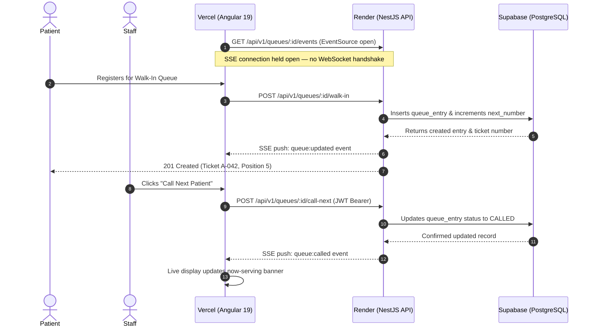

# ClinicQueue System Architecture

## 1. Overview
ClinicQueue is a real-time clinic queue management and consultation calling system designed for university clinics (such as De La Salle University - Dasmariñas). The system provides seamless queue status visibility, patient walk-in registration, consultation slot booking, and staff queue calling.

## 2. File Structure Organization

> **Monorepo-Inspired ≠ Monorepo**: This repository co-locates two self-contained apps under one Git root for developer convenience. It does **not** use a unified build graph (Turborepo/Nx), shared package workspace, or cross-app TypeScript references. Each app is built and deployed independently.

The repository layout:

```
Project-ALTF4/
├── apps/
│   ├── web/                    # Angular 19 Frontend (SPA)
│   │   ├── src/
│   │   │   ├── app/
│   │   │   │   ├── core/       # Singleton services, models, config
│   │   │   │   ├── features/   # Standalone feature components
│   │   │   │   ├── app.component.ts
│   │   │   │   ├── app.config.ts
│   │   │   │   └── app.routes.ts
│   │   │   ├── environments/   # Environment config (dev & prod)
│   │   │   └── styles.scss     # Global theme tokens & PrimeIcons
│   │   ├── angular.json        # Angular CLI workspace manifest
│   │   └── package.json        # Frontend dependencies
│   │
│   └── api/                    # NestJS 11 Backend (REST API & SSE)
│       ├── prisma/             # Database schema, migrations, seed script
│       │   ├── schema.prisma
│       │   └── seed.ts
│       ├── src/
│       │   ├── auth/           # JWT, Passport, Argon2 password hashing
│       │   ├── health/         # /health endpoint for Render checks
│       │   ├── prisma/         # PrismaService lifecycle connection
│       │   ├── queue/          # Queue REST API & Socket.IO Gateway
│       │   ├── slots/          # Clinic slots CRUD API
│       │   ├── users/          # User profile endpoints
│       │   ├── app.module.ts   # Root NestJS module
│       │   └── main.ts         # Server bootstrap, CORS, Swagger
│       ├── nest-cli.json
│       ├── package.json        # Backend dependencies
│       └── tsconfig.json
│
├── document/
│   └── Project Markdowns/      # Architecture, deployment, database docs
│       ├── architecture.md
│       ├── database-migrations.md
│       ├── deployment-vercel-render.md
│       └── environment-variables.md
├── scripts/                    # Development verification scripts
├── e2e/                        # Playwright E2E smoke tests
├── package.json                # Root workspace commands
├── render.yaml                 # Render Infrastructure-as-Code
├── vercel.json                 # Vercel deployment & rewrite configuration
├── .env.example                # Safe environment variable documentation
├── .gitignore                  # Git ignore rules protecting secrets
└── README.md                   # Project overview & quickstart
```

## 3. Technology Stack & Responsibilities

| Tier | Technology | Platform / Host | Responsibilities |
| :--- | :--- | :--- | :--- |
| **Frontend** | Angular 19, SCSS, PrimeNG 19, RxJS | Vercel | Patient walk-in portal, live display board, staff dashboard, reactive forms, native `EventSource` SSE client. |
| **Backend** | NestJS 11, TypeScript, `@nestjs/sse`, Passport JWT, Argon2 | Render (Web Service) | RESTful APIs (`/api/v1`), Swagger documentation (`/api/docs`), SSE push endpoint (`queue:called`, `queue:updated`), database access. |
| **Database** | PostgreSQL 15+, Prisma ORM 6 | Supabase | Relational data persistence, transaction pooling via PgBouncer, direct connection for migrations. |
| **DevOps & E2E**| Git, npm scripts, Playwright | GitHub | Source control, shared root scripts, CI/CD deployment pipelines. |

## 4. Communication & Data Flow



## 5. Security & Isolation Boundaries
1. **No Shared Secrets in Browser**: `DATABASE_URL`, `DIRECT_URL`, and `JWT_SECRET` reside strictly on Render. Angular only receives the public URL of the Render API.
2. **Explicit CORS**: The NestJS backend explicitly permits origins specified in `CORS_ORIGINS` (e.g. `http://localhost:4200` locally and `https://clinicqueue.vercel.app` in production).
3. **Password Security**: Argon2id hashes with salts are generated during user registration and seed creation.
4. **Health Check Sanitization**: The `/health` endpoint exposes operational status (`ok`, uptime, database connected/disconnected) without revealing database connection strings, credentials, or hostnames.
